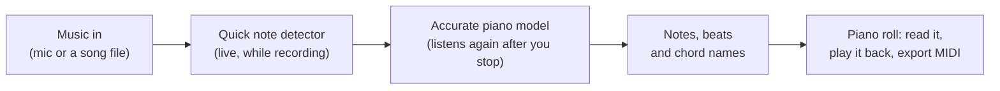

# Semitone

**By Freeman Miller**, for my Computer Science + Music portfolio.

Semitone is an iPhone app that listens to music and writes out the notes and chords as it hears
them.

**Demo video:** [DEMO VIDEO LINK]

## Why I built it

I learn songs by ear, and it's slow: I play a passage back again and again, hunting for each note.
People with perfect pitch just hear the notes. I wanted a tool that would let me hear it the way they
do.

## How it works

1. **It listens.** Record with the phone's microphone, or bring in a song file.
2. **It writes notes as you go.** A small, fast model draws notes on screen about two seconds
   behind the music.
3. **It listens again, more carefully.** When you stop, a larger piano model goes back over the whole
   recording. It catches notes the quick pass missed, and works out how hard each note was played and
   when the sustain pedal was down.
4. **It finds the beat and the chords.** It finds the bars and names the chords beat by beat. In Song
   mode it also splits the notes into melody, chords and bass.
5. **You read it, play it back, or take it into a DAW.** The notes appear on a piano roll, as falling
   notes or as a horizontal roll. They play back on a sampled grand piano and export as a MIDI file.

Everything runs on the phone, and the audio never leaves it. An optional AI cleanup sends only the
detected notes, as text.

## How I built it: me and Claude

I'm Freeman Miller. I built Semitone with Claude, Anthropic's AI, through Claude Code. To be clear about who did what:

- **Claude wrote nearly all of the code.** That includes the iPhone app, the rebuilt piano model, the
  scoring tools and most of the documentation.
- **I proposed most of the technical approaches** below. Claude built them and ran the tuning
  experiments.
- **I decided what Semitone should be and do.** I chose what it shows and how it should look and
  feel, usually by picking between design options Claude mocked up.
- **I tested it and drove the work.** I tested it on my own iPhone, reported what was wrong, and
  decided which experiments to run and which results to keep.
- **I made the MIDI/audio test pairs in Ableton.** They're the answer keys the app is scored against.
- **My partner Joss** ([@johenaught](https://github.com/johenaught)) contributed bug fixes and the
  PianoBench evaluator, also written with an AI assistant (OpenAI's Codex).

I'm now working through the codebase line by line;
[Where it's stuck, and what I'm learning](#where-its-stuck-and-what-im-learning) explains why.

## What it does, and the decisions behind it

### The idea and the product

Semitone is designed around one moment: you hear something and want to play it.

- **Recording comes first.** Home lists your recordings ("Tones") with a big record button. Each
  recording uses one of three modes: Piano, Instrument or Song.
- **Notes look the way a pianist reads them.** They're drawn against a real 88-key keyboard, not as a
  graph of the sound. Hold the keyboard and pull it round the corner to switch between falling notes
  and a horizontal roll. Turned sideways, the phone always shows falling notes across all 88 keys.
- **Each part gets its own colour.** Song mode colours the melody, chords and bass differently, so
  you can tell the lines apart. Any part can be hidden or muted.
- **Chords two ways.** Chords can be shown as played, or simplified to plain shapes you can play.

### Built on two open-source models

Semitone's note detection starts from two models that other people trained:

- **Basic Pitch**, by Spotify: fast enough to run live while you record.
- **Transkun**, by Yujia Yan: a highly accurate piano model.

We used them as the foundation and built on top of them to get better results than either gives on
its own:

- **Transkun runs on the phone.** It was a research model that needs a computer. We rebuilt it in
  Swift and Apple's Core ML so it runs on the iPhone. We also added playback of the sustain pedal
  and how hard each note was played, both of which it detects.
- **The two models check each other.** The app compares their notes and picks the more trustworthy
  version. It drops notes that can't be heard starting in the audio, and moves late bass notes to
  where they really begin.
- **Musical structure the models don't give.** The models only output notes. Semitone adds the beat
  and bars, chord names, the melody, chords and bass as separate parts, simplified chords you can
  play, and MIDI export.

Together these raised Song mode's score on ten real songs from 51.8 to 75.1 out of 100. The models
themselves were not retrained: our attempt to do that made them worse (see
[Where it's stuck](#where-its-stuck-and-what-im-learning)). The improvements are in what Semitone
does with their output.

### Architecture decisions, and why

I proposed most of these and Claude built them. Each one stayed because it held up on my test pairs
and on my phone.

- **Two passes.** Basic Pitch (Spotify) is small enough to run live, so you see notes while you play.
  Transkun v2 (Yujia Yan) is much more accurate but too heavy for real time, so it runs once you stop.
  You get instant feedback and an accurate final result.
- **The piano model runs on the phone.** Transkun is a research model written for PyTorch. It was
  rebuilt with Swift and Apple's Core ML so it runs on the iPhone's Neural Engine, with no server. On
  an iPhone 17 it takes about 4 seconds per minute of audio.
- **One layer kept at full precision.** Running the whole model at half precision (smaller, faster
  numbers) ruined its accuracy. Testing layer by layer showed only the last one needed full
  precision. With that one layer at full precision, the app gets the same notes as the
  full-precision model, about 9× faster.
- **Every note has to be heard starting.** In a full band, held synths and echoes fool both models
  into seeing new notes. A note the two models don't both find is kept only if the audio shows that
  note actually starting.
- **A beat tracker that knows about bars.** It follows the music's position within each bar, using a
  published method (Krebs, Böck & Widmer, 2015), instead of snapping to the nearest note. That's what
  lets the app number the bars and name chords on the beat.

### The MIDI/audio test pairs

I made matched MIDI/audio pairs in Ableton Live: a recording, plus a MIDI file of exactly the notes in
it. Because I know which notes are really in the audio, I can score the app's output against them.
[data/README.md](data/README.md) explains how they're made.

- **Two piano pairs.** An 8-second clip (35 notes), and a 4½-minute piece in 10/8 (1,295 notes) whose
  tempo drifts in the second half.
- **What they decided.** On the long clip, Basic Pitch scored 0.845 for finding notes and Transkun
  0.972, where 1.0 means every note found with nothing extra. That gap is why the app listens again
  with Transkun. The pairs also showed how precise the phone's copy of the model had to be, and were
  used to tune the beat tracker.
- **What I learned.** An answer key only helps if its timing matches the recording. My long clip's
  MIDI has no tempo information, so its beats didn't line up with the audio. Scored as it was, every
  model looked about 45% accurate, which hid the real differences. The numbers only meant something
  once the MIDI was lined up with the audio, bar by bar.

For full songs, the app is also scored on ten commercial recordings I chose. Their answer keys are
fan-made MIDI files, lined up with each recording automatically (`Tools/RealBench/bitmidi`). Claude
ran three overnight rounds of tuning against them. Song mode's overall score rose from 51.8 to 75.1
out of 100, with beat accuracy reaching 0.92 and chords 0.74. The recordings aren't included because
they're copyrighted.

## Where it's stuck, and what I'm learning

Semitone has hit a wall, and AI-written code alone won't get it past.

**The app is only as good as models other people trained.** Transkun is excellent on solo piano
because it was trained on piano. On a full band, Semitone still uses a piano model and patches the
gaps with hand-made rules.

**The obvious next step failed.** That step is to train the model further on more instruments. Claude
set up two training runs on public datasets of real and synthesized recordings. On my ten
real songs, both did worse than the model they started from (0.25 and 0.28, against 0.31). I
couldn't tell why, and neither could more tuning. The training data, the training method or the way
it was scored could each be the cause, and judging that takes understanding I don't have yet.

That's the point where directing an AI stops being enough. To get Semitone past piano, I need to
understand it myself:

- **Programming:** Python first (the language the models are trained in), then reading the app's
  Swift for real.
- **Machine learning:** how models learn from data, why training can make a model worse, and how to
  build a training set that teaches what I need.
- **Audio and signal processing:** what a recording actually holds, and why a held synth chord fools
  a note detector.
- **Music theory and production:** I already use these to build test pairs in Ableton. They're also
  how I'll judge whether a transcription is musically right, not just numerically close.

Those are what I want to study in Computer Science + Music.

## Tools

- Claude (Anthropic), through Claude Code: wrote nearly all of the code; see
  [How I built it](#how-i-built-it-me-and-claude)
- Swift and SwiftUI (iOS 26), Core ML and Accelerate
- Python for the benchmark and model-conversion tools
- Ableton Live for the test pairs

**Credits**

- [Basic Pitch](https://github.com/spotify/basic-pitch) by Spotify (Apache 2.0): the live note detector, converted to Core ML
- [Transkun](https://github.com/Yujia-Yan/Transkun) by Yujia Yan (MIT): the piano model, rebuilt in Swift and Core ML
- YDP Grand Piano by FreePats (CC BY 3.0)
- Joss ([@johenaught](https://github.com/johenaught)) contributed bug fixes and the PianoBench
  evaluator (`Tools/PianoBench`)

## Running it locally

You need a Mac with Xcode 26 or later.

1. Open `Semitone.xcodeproj`.
2. Choose the **Semitone Tests** scheme and an iOS 26 simulator, then press Run. To run it on an
   iPhone, set your own signing team.

Two large files aren't in the repo. The app builds and runs without them, but:

- `Semitone/TranskunBackbone.mlpackage` (30 MB) is the accurate piano pass. Without it, the app
  keeps the quick notes. Rebuild it with `Tools/PianoModel/convert_backbone.py`; its requirements are
  listed at the top of the script.
- `Semitone/GrandPiano.sf2` (35 MB) is the playback piano. Without it, playback is silent. Make it
  from the FreePats YDP Grand with `Tools/PianoSound/slim_sf2.py`, as described in
  [Tools/PianoSound](Tools/PianoSound/README.md).

## Layout

| Path | What |
|---|---|
| `Semitone/` | The app. `Transcription/` holds note detection, beat tracking and chord naming; `Transcription/Piano/` is the Swift port of Transkun. |
| `SemitoneTests/`, `SemitoneUITests/` | Unit and UI tests |
| `data/` | The MIDI/audio test pairs |
| `Tools/RealBench` | Scores the app on real recordings against an answer key |
| `Tools/MusicBench` | Makes multi-instrument test songs with exact answer keys, and scores Song mode stage by stage |
| `Tools/PianoModel` | Converts Transkun to Core ML and checks the Swift version against the original |
| `Tools/BeatTracker` | The beat tracker's prototype and test results |

## Roadmap

- **Several instruments at once.** Separate a full band into guitar, bass, drums and voice, and
  transcribe each one. Song mode already splits melody, chords and bass, but from a single
  piano-style transcription. Drum transcription was tried and taken out until it's accurate enough.
- **A proper single-instrument mode.** Instrument mode, for one line such as a voice or a violin,
  currently borrows Song mode's process. It needs a detector built for single lines.
- **Practice tools.** Slowing down to half or three-quarter speed, looping a few bars, and keys that
  glow as notes play are built on a separate branch and still being tested.
